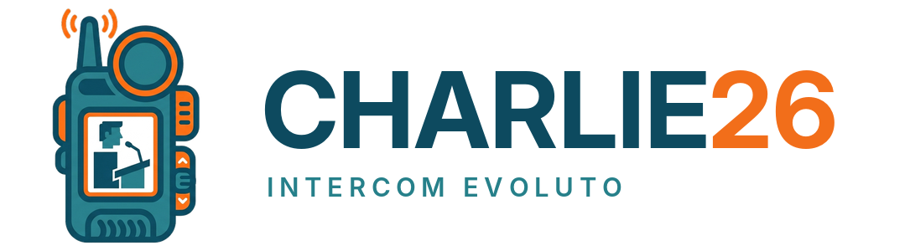

<p align="center"></p>

# CHARLIE26 – Intercom Evoluto

Intercom per eventi che funziona dal browser dello smartphone. Si lancia un solo programma sul computer di regia, e i tecnici inquadrano un QR code. Non devono installare niente e non serve internet.

> **Stato: Fase 7**: canali e logica intercom, ruoli e permessi, libero accesso o credenziali, console di regia completa (rete, QR stampabili, modelli di evento), **video** (dalla regia, da OBS e dai telefoni, con consenso e qualità selezionabile), avatar, riduzione rumore forte.

## Come funziona

```
📱 Telefono ──voce──▶ 💻 Computer di regia ──voce──▶ 📱 altri telefoni
                       (charlie26.exe: riceve ogni voce
                        e la smista a chi deve sentirla)
```

- Il computer di regia fa da centralino (SFU WebRTC). Le voci non vengono mescolate: ogni flusso viene inoltrato così com'è, per avere la latenza più bassa possibile.
- Le pagine sono in **HTTPS**, perché senza HTTPS i browser bloccano il microfono.
- Tutto il traffico audio passa da **una sola porta UDP** (predefinita 8443).

## Guida rapida per l'evento

**Prima (a casa o in ufficio)**
1. Avvia il programma e prepara l'evento dalla console: modalità di accesso, canali, utenti, sfondi. Salvalo come **modello** (scheda *Evento*) o **esportalo** su file.
2. Con le credenziali: scheda **QR → Stampa / salva PDF**, e ritaglia i QR personali.
3. Se usi OBS: copia in OBS indirizzo e chiave della scheda *Video* (servizio WHIP).

**In regia, all'arrivo**
1. Collega il PC alla rete dell'evento (meglio via cavo) e avvia `charlie26`.
2. Controlla in console la **rete usata nei QR** (colonna sinistra): deve essere quella su cui stanno i telefoni.
3. Carica il modello dell'evento, se l'hai preparato.
4. Apri il **pannello intercom** (in basso) e prova un tasto PARLA.
5. Fai inquadrare il QR a un tecnico e fate una prova voce nei due sensi. Se il telefono dice "connessione non privata", usate il **QR di aiuto**.

**Durante**
- **PARLA A TUTTI** con la barra Spazio, i singoli canali con i tasti 1–9.
- Richieste video: compaiono nelle anteprime con **Approva / Rifiuta**.
- Se un telefono perde la connessione si ricollega da solo. Se resta grigio, ricaricare la pagina.
- Scheda **Registro** per capire cosa succede.

**Dopo**
- *Evento → Spegni il programma* (o, su Windows, l'icona vicino all'orologio → *Esci*).
- Se l'evento si ripete, salva il modello aggiornato.

**Se qualcosa non va**
| Problema | Cosa fare |
|---|---|
| Il telefono non apre la pagina | stessa rete del PC? Rete giusta scelta nei QR? Su Windows, al primo avvio, hai consentito le **Reti private**? |
| "Connessione non privata" | Android: *Avanzate → Procedi*; iPhone: *Mostra dettagli → visita questo sito web*. Definitivo: QR di aiuto, installa il certificato |
| Il microfono non parte | il browser deve avere il permesso: rispondi *Consenti*. iPhone: *Impostazioni › Safari › Microfono* |
| Si sente a scatti | troppi video in qualità alta sulla stessa rete Wi-Fi: passare a *Bassa* |
| Il programma non si avvia | leggi la finestrella di errore; di solito una porta è occupata da un'altra copia o da un altro programma |

## Scaricare il programma

**Versioni ufficiali**: nella pagina del progetto su GitHub, sezione **Releases** (a destra), scarica il file per il tuo sistema. Ogni release contiene anche `SHA256SUMS.txt` per verificare i file.

**Ultima versione in sviluppo**: **Actions → Compila**, l'esecuzione più recente, in fondo **charlie26**. Dentro trovi:

| File | Per |
|---|---|
| `charlie26-windows-amd64.exe` | Windows 10/11 |
| `charlie26-darwin-arm64` | Mac con chip Apple (M1, M2, M3…) |
| `charlie26-darwin-amd64` | Mac con processore Intel |
| `charlie26-android.apk` | App per telefoni Android (facoltativa: il browser basta) |

### Primo avvio su Windows
1. Doppio clic su `charlie26-windows-amd64.exe`. Se compare "Windows ha protetto il PC", scegli **Ulteriori informazioni → Esegui comunque**.
2. Al primo avvio Windows chiede se consentire l'accesso alla rete: spunta **Reti private** e premi **Consenti**. Senza questo passaggio i telefoni non si collegano.
3. Si apre nel browser la **console di regia**. Non compare nessuna finestra nera: il programma resta attivo come **icona vicino all'orologio** (un microfono bianco su un tondo rosso; se non la vedi, cercala sotto la freccetta ˄).
   - **clic sinistro** sull'icona: riapre la console;
   - **clic destro**: *Apri console di regia*, *Apri cartella dati*, *Esci (spegne l'intercom)*.
4. Se fai di nuovo doppio clic sul programma già acceso, si apre semplicemente la sua console.
5. Se qualcosa impedisce l'avvio (per esempio una porta occupata), compare una finestrella con la spiegazione.

### Primo avvio su Mac
I file non sono firmati da Apple, quindi va fatto un passaggio in più:
1. apri il Terminale nella cartella del file;
2. `chmod +x charlie26-darwin-arm64` (oppure `-amd64`);
3. `xattr -d com.apple.quarantine charlie26-darwin-arm64`;
4. `./charlie26-darwin-arm64`.

## Collegare i telefoni

1. Telefono e computer di regia devono stare **sulla stessa rete** (stesso Wi-Fi o switch).
2. Inquadra il **QR per i tecnici** mostrato nella console.
3. La prima volta compare l'avviso "connessione non privata". Si risolve in due modi:
   - **veloce**: Android: *Avanzate → Procedi*; iPhone: *Mostra dettagli → visita questo sito web*;
   - **definitivo**: inquadra il **QR di aiuto** e installa il certificato della regia (istruzioni nella pagina).
4. Scrivi il nome, premi **Entra** e rispondi **Consenti** al microfono.

**Pulsante microfono:** un tocco breve lo apre e lo chiude. Se lo tieni premuto, parli finché non lo rilasci (push-to-talk).

## Console di regia

Si apre da sola all'avvio (`https://localhost:8443/regia`) ed è pensata per stare in uno schermo 16:9:
- **a sinistra**: QR per i tecnici, QR di aiuto per il certificato, **rete usata nei QR** (se il PC ha più schede di rete, si sceglie qui; la scelta viene ricordata), **anteprime video** (qualità bassa, massimo 15 fps; clic = grande in qualità alta);
- **in alto a destra, Configurazione**, con le schede:
  - *Evento*: nome, modalità di accesso, **telefoni di regia abbinati** (vedi sotto), **modelli di evento** (salva la configurazione con un nome, ricaricala con un clic);
  - *Canali*, *Utenti*;
  - *Video*: invio di periferiche del browser, indirizzo e chiave per OBS, richieste da approvare (vedi sotto);
  - *QR*: QR generale, **QR per canale** (libero accesso: l'app propone già quel canale) o **QR personale per utente** (credenziali: si entra senza password), ognuno scaricabile in PNG; **Stampa / salva PDF** apre un foglio A4 con le schede da ritagliare;
  - *Registro*: i messaggi del programma, salvati anche in `intercom.log` nella cartella dati;
- **in basso a destra, Intercom**: tasti PARLA per canale, PARLA A TUTTI, lista dei collegati.
- **in alto, accanto alle schede**: **📱 Abbina telefono**, **Esporta / Importa** la configurazione su file `.json`, **Spegni** (chiude il programma e solo la scheda della console).
- I bordi tra i riquadri si **trascinano** per cambiarne le misure (doppio clic: misure originali).

## Regia da smartphone

La console sul PC resta sempre attiva; in più puoi **abbinare uno o più telefoni come regia** (un secondo responsabile di produzione, con tutti i comandi).

1. Nella console premi **📱 Abbina telefono**: compare un QR.
2. Inquadralo con la fotocamera del telefono (o con l'app CHARLIE26) e dai un nome al telefono.
3. Il telefono mostra la console: in alto i pulsanti **🎙 Intercom, Evento, Canali, Utenti, QR, Video, Registro**, e il menu **☰** con *Esporta*, *Importa*, *Abbina un altro telefono*, *Termina evento* (spegne CHARLIE26 per tutti) e *Esci / Chiudi app*.

Il QR vale **5 minuti e una sola volta**. L'abbinamento resta anche se il programma si riavvia; in *Evento → Regia da smartphone* vedi i telefoni abbinati e puoi **revocarli** (il telefono perde subito i comandi).

## Pop-up: l'intercom sopra le altre app

Il pulsante **⧉** in alto (telefoni e console) apre una **finestrella** che resta sopra le altre app:
- con il **video** della regia, se c'è;
- altrimenti con un riquadro: canali, **chi sta parlando**, **MUTO / IN ONDA**.

Nella finestrella i tasti **▶ = parla** e **⏸ = muto** (non si può tenere premuto: è un tocco per aprire e uno per chiudere; sui canali "solo push-to-talk" il pop-up non apre il microfono). Dal **browser** il pop-up funziona su Chrome per Android e per computer e su Safari; su iPhone si apre anche da solo uscendo da Safari mentre il riquadro è attivo. Nell'**app Android** si apre **da solo** quando passi a un'altra app.

## App Android

Facoltativa: tutto funziona anche dal browser. In più l'app:
- si apre con la **fotocamera** per leggere il QR (tecnici, caporeparto o **📱 abbinamento regia**) e ricorda gli eventi recenti (**Riapri**);
- si fida **solo** del certificato dell'evento indicato dal QR (nessun avviso "connessione non privata" e nessun rischio che un altro dispositivo si spacci per la regia);
- resta attiva con l'**app in secondo piano**: notifica fissa con stato e tasto **Parla / Muto**, e **pop-up automatico** con video e tasto parla;
- salva l'esportazione della configurazione nella cartella **Download**.

**Installazione**: scarica `charlie26-android.apk` sul telefono (dalla release o dal tab Actions), aprilo e consenti *Installa app sconosciute* per il browser o per l'app File. Richiede Android 10 o successivo. Al primo uso consenti **fotocamera**, **microfono** e **notifiche**.

**Firma dell'app**: per installare gli aggiornamenti sopra la versione precedente l'APK va firmato sempre con la stessa chiave. Finché la chiave non è configurata nei *Secrets* di GitHub (`ANDROID_KEYSTORE_B64`, `ANDROID_KEYSTORE_PASSWORD`) la compilazione produce un APK di prova: per aggiornarlo va prima disinstallata la versione vecchia (e il telefono di regia va riabbinato).

**iPhone**: il progetto è pronto per aggiungere iOS con lo stesso codice (Capacitor); per installarla servono un account Apple Developer e un Mac per la firma.

## Video

Ci possono essere **più video contemporaneamente**, ognuno destinato a uno o più canali.

| Chi | Da dove | Dove arriva |
|---|---|---|
| **Regia** | console, scheda *Video*: una periferica del browser (scheda di acquisizione, webcam, **OBS Virtual Camera**, **vMix Video**). Se ne possono avviare più di una | nei canali scelti, **subito**; in ogni canale solo se il caporeparto ha attivato *Video della regia* (⚙ o scheda Canali) |
| **OBS** (WHIP) | OBS ≥ 30: *Impostazioni → Trasmissione → Servizio "WHIP"*, con l'indirizzo e la chiave (Bearer Token) mostrati nella scheda *Video* | come il video della regia; i canali si scelgono dalla console |
| **Caporeparto** | telefono, **📹 Mostra video** (fotocamera posteriore o frontale) | **subito** nei canali di cui è caporeparto; in Produzione serve il consenso della regia |
| **Tecnico** | telefono, **📹 Mostra video** | parte solo quando un caporeparto di quel canale (o la regia) preme **Approva**. Chi deve decidere riceve un avviso e vede l'anteprima |

- **Fermare un video**: chi lo invia, il caporeparto del canale o la regia. Il video della regia lo ferma solo la regia; il caporeparto può solo non farlo arrivare nel suo canale.
- **Qualità** (telefono, sopra i video): **Alta**, **Bassa** (circa 360p, 15 fps: consuma poco) o **Spento**. Tocca un video per vederlo a schermo intero.
- I video dal browser partono sempre in due versioni, alta e bassa, e il server manda a ognuno quella scelta, cambiando senza interruzioni. OBS manda una sola versione: chi guarda riceve sempre quella.
- **vMix**: il modo più semplice è l'uscita *Virtual Camera* di vMix, da scegliere nella scheda *Video* della console.
- Latenza tipica in rete locale: qualche decimo di secondo.

## Personalizzazione
- **Sfondo dell'evento** (console, scheda *Evento → Aspetto*): colore e/o immagine per la pagina di accesso e le pagine dei tecnici. Sull'immagine viene steso un velo scuro, così i comandi restano leggibili al buio.
- **Icona e sfondo di ogni canale** (console, scheda *Canali*, pulsante 🎨; oppure il caporeparto con ⚙ → *Icona e sfondo del canale*): uno dei quattro mostriciattoli o un'immagine caricata, più colore e/o immagine di sfondo. Chi è in un solo canale (e il caporeparto, per il suo reparto) vede lo sfondo del canale.
- Le immagini vengono ridotte sul dispositivo prima dell'invio e salvate nella cartella `immagini` dei dati; viaggiano dentro i file esportati e i modelli, quindi una configurazione portata su un altro computer resta completa.

## Avatar
All'ingresso ognuno sceglie un avatar: uno dei quattro mostriciattoli (Bit, Byte, Pixel, Glitch) oppure una **foto** (📷). La foto viene ritagliata e ridotta sul telefono a pochi KB prima dell'invio. Si cambia anche da collegati, toccando il proprio avatar in alto.

## Modalità di accesso

Si sceglie nella **console di regia**, sezione *Configurazione evento*. La configurazione (canali, utenti, modalità) viene salvata da sola nel file `evento.json` della cartella dati e ritrovata al riavvio.

### Libero accesso (predefinita)
- Un **QR unico** per tutti. Chi entra scrive il nome e sceglie il canale.
- Chiunque può **creare un sottocanale** (anche protetto da password) e ne diventa **caporeparto**. Il telefono se lo ricorda: ricaricando la pagina si rientra da caporeparto senza rimettere la password.
- La regia può **nominare caporeparto** un tecnico dalla lista dei collegati, per esempio se chi ha creato il canale va via.

### Accesso con credenziali
- La regia crea gli **utenti** (nome utente, nome mostrato, password), con ruolo **Tecnico** o **Caporeparto** e i canali assegnati.
- Il telefono mostra il **login**. Ruolo e canali li decide la regia.
- In alternativa ognuno può inquadrare il proprio **QR personale** (scheda QR della console): compare "Ciao Marco" e basta premere Entra. Il QR contiene una chiave di accesso, non la password. Se un QR va perso, **Nuovo codice** lo rende inutilizzabile.
- Le modifiche valgono subito anche per chi è già collegato: un canale aggiunto compare sul telefono, un utente eliminato viene scollegato.
- Cambiando modalità tutti i collegati vengono scollegati e devono rientrare.

## Ruoli e permessi

| Ruolo | Canali | Poteri |
|---|---|---|
| **Regia** (console) | tutti | parla a uno, a più o a tutti i canali; configura l'evento; scollega chiunque; gestisce ogni canale |
| **Caporeparto** | Produzione + i propri reparti | due tasti PARLA; con ⚙ sul proprio canale gestisce i microfoni degli utenti |
| **Tecnico** | quelli scelti/assegnati | usa il microfono come deciso dal caporeparto |

Con l'ingranaggio ⚙ il caporeparto, e la regia su ogni canale, sceglie come gli utenti usano il microfono:
- **Libero**: tocco per aprire e chiudere, oppure tenere premuto per parlare;
- **Solo push-to-talk**: si parla solo tenendo premuto;
- **Solo il caporeparto apre**: il tecnico non può aprirsi il microfono; ci pensa il caporeparto con **Apri mic** e **Chiudi mic**. Sul telefono del tecnico compare "APERTO DAL CAPOREPARTO".

Il caporeparto può anche **chiudere il microfono** di un singolo utente in qualsiasi momento, e decidere se nel canale arriva il **video della regia** (attivo dalla Fase 5).

**Chi sente chi:** si sente chi sta parlando su un canale che si ascolta. Il caporeparto video che parla in Produzione lo sentono la regia e gli altri caporeparto, ma non i suoi cameraman. Ogni riga canale mostra chi sta parlando e ha il tasto **🔊** per smettere di ascoltare quel canale. Chi ha più canali ha anche il volume per canale; su iPhone il volume della pagina viene ignorato e conta solo quello del telefono.

**Console:** i tasti **1…9** parlano al canale corrispondente, **Spazio** a tutti. Tocco breve per agganciare, tenere premuto per parlare. Il pannello di regia e la configurazione funzionano solo sul computer di regia (`https://localhost…`).

Canali iniziali di un evento nuovo: Produzione, Video, Audio, Luci. Si cambiano dalla console oppure, solo al primo avvio, con `-principale` e `-canali`.

### Riduzione rumore forte
L'interruttore **Riduzione rumore forte** attiva RNNoise, lo stesso filtro di Jitsi Meet. Serve vicino al palco, in sala macchine o dentro un camion regia. Nelle prove ha tolto altri ~30 dB di rumore di fondo rispetto al filtro normale del browser. Aggiunge 10 ms di ritardo e consuma un po' più batteria. La scelta resta memorizzata sul telefono.

## Opzioni (avanzate)

Si passano da riga di comando, per esempio `charlie26.exe -ip 192.168.1.10`:

| Opzione | Predefinito | Cosa fa |
|---|---|---|
| `-ip` | automatico | IP da usare nei QR (se il PC ha più schede di rete) |
| `-porta` | 8443 | porta HTTPS |
| `-porta-udp` | 8443 | porta UDP per l'audio |
| `-porta-aiuto` | 8080 | pagina di aiuto in HTTP (0 = disattiva) |
| `-dati` | cartella utente | dove salvare certificati ed eventi |
| `-principale` | Produzione | nome del canale principale (solo per un evento nuovo) |
| `-canali` | Video,Audio,Luci | reparti, separati da virgola (solo per un evento nuovo) |
| `-cert`, `-key`, `-dominio` | – | certificato di un dominio vero (opzione "nessun avviso") |

Cartella dati predefinita: `%AppData%\Charlie26` su Windows e `~/Library/Application Support/Charlie26` su Mac (se trova la cartella `IntercomRegia` delle versioni precedenti, la riprende da sola). Contiene `evento.json` (configurazione; delle password è salvata solo un'impronta non reversibile, non la password in chiaro), `intercom.log` (registro dell'ultima esecuzione; quello precedente è `intercom.log.1`), `impostazioni.json` (rete scelta), le cartelle `modelli` e `immagini` e la sottocartella `certificati`. Per ripartire da un evento vuoto cancella `evento.json`; per ricreare il certificato cancella `certificati`.

### Certificato di dominio (nessun avviso sui telefoni)
Se hai un certificato valido per un dominio (es. wildcard `*.intercom.tuodominio.it`) e un DNS che risolve `192-168-1-10.intercom.tuodominio.it` su `192.168.1.10`:

```
charlie26.exe -cert fullchain.pem -key privkey.pem -dominio intercom.tuodominio.it
```

In alternativa copia i file come `dominio.crt` e `dominio.key` nella cartella `certificati` dei dati. La guida completa per ottenerli arriverà più avanti.

## Per sviluppatori

```
go test -race ./...                 # test automatici (inclusi "telefoni" simulati)
go run .                            # avvia in locale
go run ./tools/winres -version 1.0.0  # icona e versione per l'eseguibile Windows
```

**App Android** (cartella `mobile/`, Capacitor): `npm ci && npm run prepare-www && npx cap sync android`, poi `cd android && ./gradlew assembleDebug` (serve l'Android SDK). La pagina iniziale con il lettore QR è in `mobile/www/`; la parte nativa (certificato dell'evento, servizio in secondo piano, pop-up) in `mobile/android/app/src/main/java/`.

**Pubblicare una release**: su GitHub *Releases → Draft a new release*, crea un tag `vX.Y.Z` (es. `v1.0.0`) e pubblica. La compilazione automatica allega da sola i file per Windows, Mac e Android.

## Licenze di terze parti

- [RNNoise](https://github.com/xiph/rnnoise) (BSD 3 clausole), nella build WebAssembly [`@jitsi/rnnoise-wasm`](https://github.com/jitsi/rnnoise-wasm) (Apache 2.0): vedi `web/rnnoise/`.
- [Pion WebRTC](https://github.com/pion/webrtc) (MIT), [gorilla/websocket](https://github.com/gorilla/websocket) (BSD), [go-qrcode](https://github.com/skip2/go-qrcode) (MIT).
- App: [Capacitor](https://capacitorjs.com) (MIT), [jsQR](https://github.com/cozmo/jsQR) (Apache 2.0).

## Credits

**CHARLIE26 – Intercom Evoluto** · Andrea Battaglioli – [www.andreabattaglioli.it](https://www.andreabattaglioli.it) · ABit/s · Made in Bolognina
